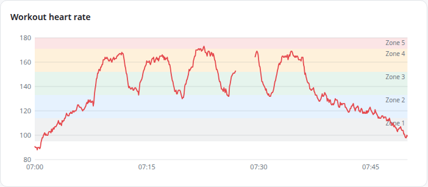
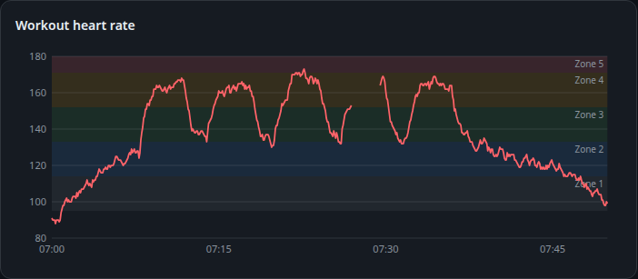
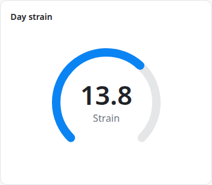
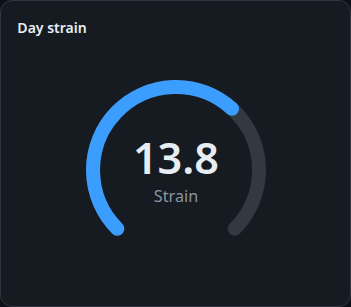
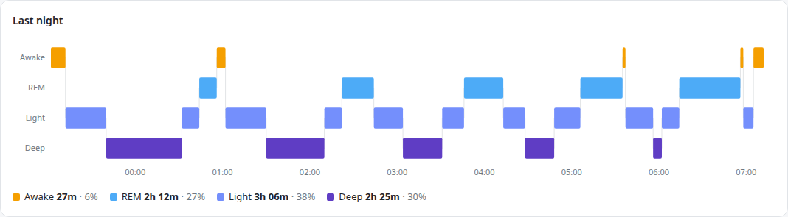
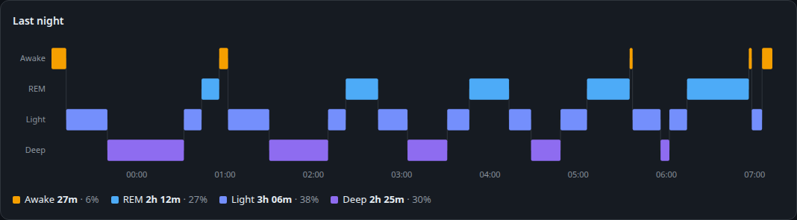
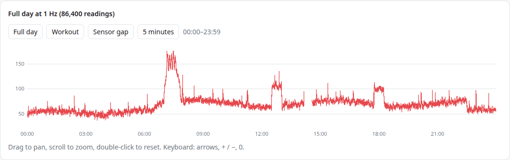
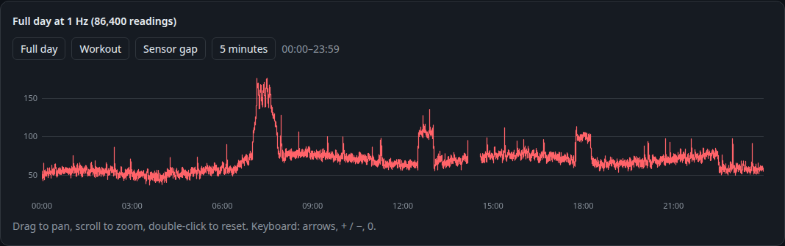

# health-charts

Small React + TypeScript chart components for health data, drawn with hand-written SVG and Canvas 2D. No charting library, no d3: scales, ticks, decimation and path building are a few hundred lines of plain, unit-tested functions.

**Live demo:** https://health-charts.pages.dev

| Component              | Renders | What it shows                                                                                                    |
| ---------------------- | ------- | ---------------------------------------------------------------------------------------------------------------- |
| `HeartRateChart`       | SVG     | Heart rate over time with shaded zones, crosshair tooltip, arrow-key navigation and a live region                |
| `SleepStagesChart`     | SVG     | Hypnogram of awake, REM, light and deep sleep with a totals legend and a text description                        |
| `StrainRing`           | SVG     | Animated 0–21 arc gauge exposed as an ARIA `meter`; skips the animation under `prefers-reduced-motion`           |
| `DenseHeartRateCanvas` | Canvas  | A full day at 1 Hz (86,400 readings) with per-pixel min/max decimation, `devicePixelRatio` scaling, pan and zoom |

All data in the demo and screenshots is **synthetic**, produced by a seeded generator in [`demo/synthetic.ts`](demo/synthetic.ts). The same seed always produces the same charts.

| Light                                          | Dark                                                |
| ---------------------------------------------- | --------------------------------------------------- |
|  |  |
|           |           |
|           |           |
|        |        |

## Why hand-written SVG and Canvas

These charts are narrow: one series, a time axis and a few domain-specific overlays. A general charting library would bring a large API to configure around those needs, and it would hide the parts that matter most here: how points become pixels, how a day of 1 Hz data stays fast, and how a chart works with a keyboard and a screen reader. Writing them directly keeps each chart readable from top to bottom and the bundle around 8 kB gzipped.

The split is deliberate:

- **`src/core/`** holds pure functions (scales, ticks, decimation, paths, pan/zoom, zones, sleep totals). They know nothing about React or the DOM and are tested directly.
- **Components** turn those results into SVG elements or Canvas calls and own interaction state.
- **SVG** is used where the element count is small and each mark benefits from being in the DOM (styling, hit testing, accessibility). **Canvas** is used where it is not: 86,400 points as SVG would be one enormous path that the browser re-rasterises on every pan.

## How it works

### Per-pixel min/max decimation

A 1,000 px wide chart of a full day has about 86 readings per pixel column. Drawing all of them is wasted work, but naive downsampling (taking every 86th reading) drops spikes. [`decimateMinMax`](src/core/decimate.ts) instead walks the visible readings once and keeps four values per column: the first, the last, the minimum and the maximum. Drawing a line to the first value, down to the minimum, up to the maximum and on to the last covers the same pixels that drawing every reading would, so spikes and dips survive at any zoom level. This is known as M4 aggregation.

Details that keep it correct and fast:

- The start of the visible window is found by binary search, so panning a zoomed-in view only scans the readings on screen.
- `NaN` readings are skipped. A column with no readings produces no bucket, and the renderer starts a new line segment when the time between buckets exceeds `gapMs`, so sensor gaps stay visible instead of being bridged by a straight line.
- The output size is bounded by the column count, not the input size.

### Canvas and `devicePixelRatio`

A canvas has two sizes: its CSS size and its backing store in device pixels. On a 2x display, a 600 × 200 CSS-pixel canvas with a 600 × 200 backing store is upscaled and blurry. [`DenseHeartRateCanvas`](src/DenseHeartRateCanvas.tsx) sets the backing store to `round(cssSize × devicePixelRatio)`, keeps the CSS size unchanged and applies `setTransform(ratio, 0, 0, ratio, 0, 0)`, so every drawing call is written in CSS pixels and still lands on device pixels.

It also decimates at device resolution (one bucket per device pixel column), redraws when its container resizes (`ResizeObserver`) and when the pixel ratio changes, for example when the window moves to another monitor or the page is zoomed (a re-armed `matchMedia('(resolution: …dppx)')` query).

Wheel zoom is registered as a non-passive native listener because React attaches wheel handlers as passive, and passive listeners cannot stop the page from scrolling.

## Usage

The package is not published to npm yet; `npm run build` produces `dist/` for local use.

```tsx
import {
  DenseHeartRateCanvas,
  HeartRateChart,
  SleepStagesChart,
  StrainRing,
  type HeartRateSample,
  type SleepSegment,
} from 'health-charts';

const samples: HeartRateSample[] = [
  { time: Date.parse('2026-03-14T07:00:00'), bpm: 92 },
  { time: Date.parse('2026-03-14T07:00:05'), bpm: 95 },
  // ...
];

<HeartRateChart data={samples} maxHeartRate={190} height={240} />;
```

```tsx
const night: SleepSegment[] = [
  {
    stage: 'light',
    start: Date.parse('2026-03-13T23:10:00'),
    end: Date.parse('2026-03-13T23:35:00'),
  },
  {
    stage: 'deep',
    start: Date.parse('2026-03-13T23:35:00'),
    end: Date.parse('2026-03-14T00:20:00'),
  },
  // ...
];

<SleepStagesChart segments={night} />;
<StrainRing value={13.8} size={180} />;
```

`DenseHeartRateCanvas` takes parallel typed arrays, which avoid allocating 86,400 objects. Pan and zoom are uncontrolled by default; pass `domain` and `onDomainChange` to control them:

```tsx
const [domain, setDomain] = useState<[number, number]>([dayStart, dayEnd]);

<DenseHeartRateCanvas times={times} values={values} domain={domain} onDomainChange={setDomain} />;
```

Interaction: drag to pan, scroll to zoom around the cursor, double-click to reset. With focus, the arrow keys pan, `+` / `-` zoom and `0` resets.

### Theming

Every color is a CSS custom property with a fallback, so the charts work unstyled and theme from plain CSS:

```css
:root[data-theme='dark'] {
  --hc-text: #e6edf3;
  --hc-muted: #8b949e;
  --hc-grid: rgba(139, 148, 158, 0.22);
  --hc-line: #ff6369;
  --hc-surface: #21262d;
}
```

Other tokens: `--hc-track`, `--hc-strain`, `--hc-zone-1` to `--hc-zone-5`, `--hc-awake`, `--hc-rem`, `--hc-light`, `--hc-deep`. SVG components pick up changes immediately. Canvas cannot read `var()`, so the canvas resolves `--hc-line`, `--hc-muted` and `--hc-grid` from computed style each time it draws; after a theme switch, trigger a redraw (the demo remounts it with `key={theme}`).

## Accessibility

- `HeartRateChart` is a focusable group with a text summary. Arrow keys, Page Up/Down, Home and End move between readings; each keyboard move is announced through a polite live region (pointer hover is not, to avoid flooding the screen reader) (`"07:12, 164 bpm, Zone 4"`). Escape clears the selection.
- `SleepStagesChart` is an `img` with a `<title>` and a `<desc>` that states the time range and each stage total. The legend is a real list.
- `StrainRing` is a `meter` with `aria-valuenow` and `aria-valuetext`, and the animation is skipped when the user prefers reduced motion.
- `DenseHeartRateCanvas` is a focusable group whose accessible name describes the visible window and its bpm range. Keyboard pans and zooms announce the new window through a live region; the canvas itself is hidden from assistive technology.

## Development

Requires Node 22 and npm 11 (the lockfile is written by npm 11; `npx npm@11 ci` works on a stock Node 22).

| Script                     | What it does                                                   |
| -------------------------- | -------------------------------------------------------------- |
| `npm run dev`              | Demo page with hot reload                                      |
| `npm run build`            | Library bundle (`dist/health-charts.js`) and type declarations |
| `npm test`                 | Vitest unit and component tests (jsdom)                        |
| `npm run test:e2e`         | Playwright tests against the demo in Chromium                  |
| `npm run docs:screenshots` | Regenerates the PNGs in `docs/`                                |
| `npm run lint`             | ESLint (type-checked rules) and Prettier check                 |
| `npm run typecheck`        | `tsc` in strict mode                                           |

The Playwright tests check that the canvas paints non-blank pixels, that its backing store matches the CSS size at 1x and 2x, that wheel zoom and the zoom presets change the visible window, and that keyboard navigation announces readings.

## License

[MIT](LICENSE) © Matthew Fehrsen
